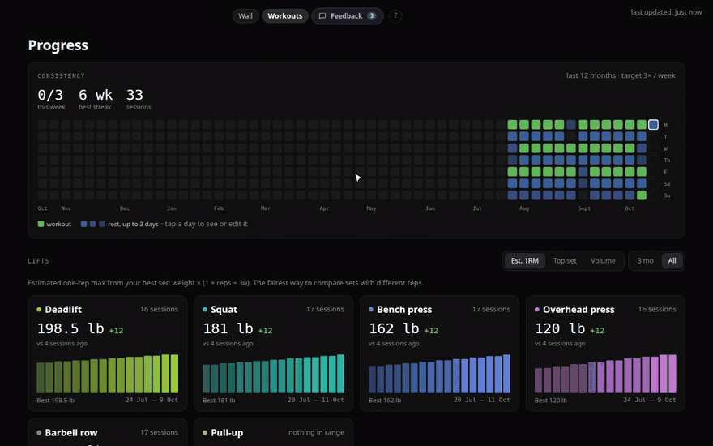
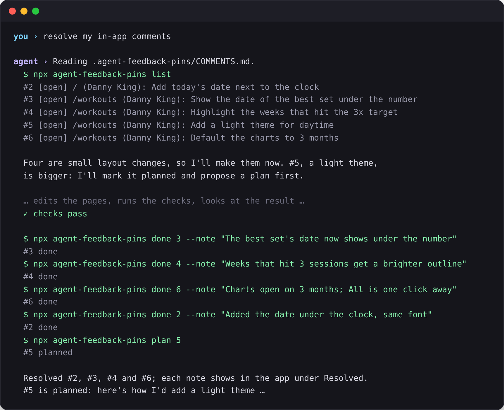
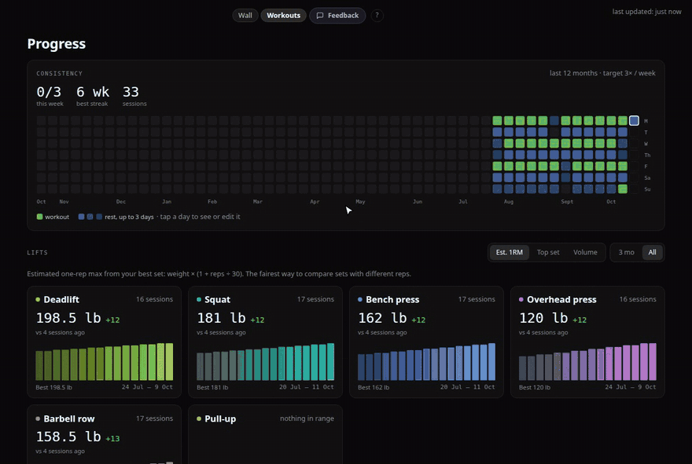
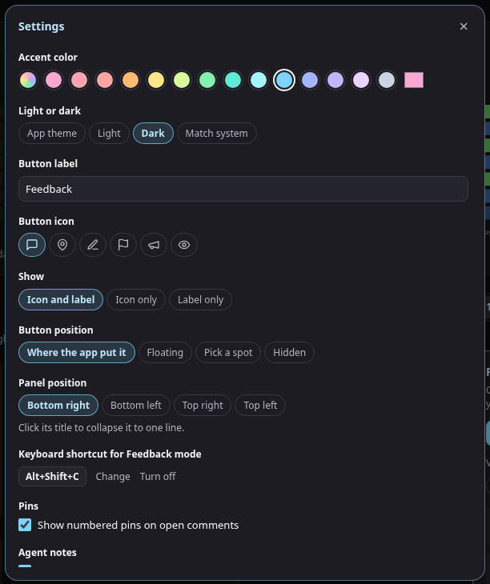

# Agent feedback pins

While you develop any web app, add a temporary Feedback button so you can pin comments to page
elements for your AI agents to act on. It's inspired by
[plannotator-tui](https://github.com/plannotator/plannotator-tui) and Claude's design mode. Your
comments are saved to a Markdown file in the project. Your agent picks them up and works through
them when you use the included skill, or when you ask it to resolve the in-app comments you left.
It's easy to remove when you're ready to ship.


## How it works

1. **Install it in a project.** Your agent adds a **Feedback** button to the app (dev server
   only) and a `.agent-feedback-pins/` folder at the root of your repo, where comments are kept.
2. **Leave comments.** Click **Feedback** (or press **⌥⇧C** on a Mac, **Alt+Shift+C** on
   Windows and Linux), click any part of the page and type what should change. Each comment is
   pinned to that element with a numbered marker, and saved with the page, the element's
   selector, its nearest heading and text, its position and who wrote it.
3. **Comments land in `.agent-feedback-pins/COMMENTS.md`**, a readable list grouped by page,
   for people and agents. `feedback.jsonl` beside it is the source of truth, and
   `settings.json` holds the overlay's settings. The panel shows where the folder is.
4. **Ask your agent to "resolve my in-app comments".** It reads `COMMENTS.md`, finds the code,
   makes the changes, and marks each comment done with a short note on what it changed.
5. **Check the result in the app.** **Resolved** in the panel lists every comment with who
   resolved it, when and their note. Mark one unresolved to send it back: it shows up in
   `COMMENTS.md` again as reopened, with its history, so the agent knows its first try fell
   short.



Feedback mode's panel: **Pin comment** for a comment on one element, **Whole page** for one
about the page as a whole, **View comments** for this page's or every page's open comments,
and **Resolved** for the full history. Click the title to collapse the panel to one line.



<sub>An illustration of an agent session. The commands and their output are real; the agent's
own words will vary.</sub>



## Install

Tell your coding agent (Claude Code, Codex, OpenCode, Pi or similar):

> Add https://github.com/dannyking/agent-feedback-pins to this project

It sets things up to fit your stack. Then click **Feedback** in your app, leave comments, and ask
your agent to "resolve my in-app comments". To have the skill available in every project, see
[Install the skill](#install-the-skill). To set it up yourself, see
[Install by hand](#install-by-hand).

## Dev only

agent-feedback-pins is for building an app, not for its users, and it never ships:

- **It loads only in development.** The Vite plugin runs on the dev server alone, so a
  production build contains no trace of it. Other stacks gate the middleware and the script tag
  on dev mode (or an environment variable), and the install checks a production build has no
  `__afp` reference.
- **It writes into your working copy.** Comments are files in `.agent-feedback-pins/`, which is
  added to `.gitignore` unless you want them in the repo.
- **Anyone who can reach your dev server can comment**, attributed by default to the git
  identity of whoever runs it. Apps with their own logins can name the signed-in person instead
  (see [Comment authors](#comment-authors)).
- **Everything it touches is marked** with a comment containing `agent-feedback-pins`, in as
  few places as possible, so removing it is a search and one small diff.

## Update

Ask your agent:

> Update agent-feedback-pins to the latest version

Settings shows the installed version and tells you when a newer one is on GitHub.

By hand, update the dev dependency to the latest commit on `main` and restart the dev server:

```sh
pnpm update agent-feedback-pins          # or: npm install -D github:dannyking/agent-feedback-pins
                                         #     yarn upgrade agent-feedback-pins / bun update agent-feedback-pins
git -C ~/projects/agent-feedback-pins pull   # if you cloned it for the skill
```

The standalone collector picks up the latest with
`npx --yes github:dannyking/agent-feedback-pins#main serve`.

**Your comments are never changed or lost by an update.** They live in your project's
`.agent-feedback-pins/` folder, not in the package. (One rename so far: `FEEDBACK.md` became
`COMMENTS.md` in 0.2.0, rewritten from `feedback.jsonl` the next time a comment is saved.)

## Remove

Ask your agent:

> Remove the feedback pins

**Settings › Remove** shows the same steps in the app, with a prompt to copy for your agent
that either keeps your comments or deletes them.

**Removing it can delete your comments.** Each comment and its history lives in
`.agent-feedback-pins/`; to keep them, keep that folder (or copy it somewhere first).

By hand:

1. Search the project for `agent-feedback-pins` and `__afp` (code, templates, configs, scripts)
   and delete each integration block.
2. Uninstall the dev dependency (`pnpm remove agent-feedback-pins`, or your package manager's
   equivalent).
3. Keep or delete `.agent-feedback-pins/`, the history of your comments. If you delete it,
   remove its line from `.gitignore`.
4. Build for production and confirm nothing references `__afp`.

## Pieces

- `client/agent-feedback-pins.js`: the overlay. No dependencies or build step, rendered in shadow
  DOM so it doesn't touch your styles. Themed with `--afp-*` CSS variables.
- `agent-feedback-pins` (Node): `createHandler()` serves the client and a small JSON API under
  `/__afp` as Connect-style middleware; `injectHtml()` adds the script tag.
- `agent-feedback-pins/vite`: a Vite plugin (dev server only).
- `bin/agent-feedback-pins.js`: a standalone collector for any stack, plus `list`, `done`,
  `dismiss`, `plan`, `reopen` and `render`. Status changes are logged in each comment's
  `history`, with the agent that made them: detected from `AFP_AGENT`, `AI_AGENT` or Claude
  Code's `CLAUDECODE`, or given with `--by "<agent name>"`; otherwise the git identity. `--note`
  records what was changed; `done` and `dismiss` require it while agent notes are on.
- `skill/SKILL.md`: an agent skill that installs it to fit the project's stack, processes the
  feedback, and removes it.

## Install the skill

The skill (`skill/SKILL.md`) lets your coding agent add this to a project in a way that fits its
stack, work through the feedback, and remove it before shipping. Clone the repo once, then link
the skill where your agent looks for skills:

```sh
git clone https://github.com/dannyking/agent-feedback-pins ~/projects/agent-feedback-pins

# Claude Code
ln -s ~/projects/agent-feedback-pins/skill ~/.claude/skills/agent-feedback-pins

# Codex, OpenCode and Pi all read the shared Agent Skills folder
mkdir -p ~/.agents/skills
ln -s ~/projects/agent-feedback-pins/skill ~/.agents/skills/agent-feedback-pins
```

OpenCode also reads `~/.claude/skills`, and has its own `~/.config/opencode/skills`; Pi has
`~/.pi/agent/skills`. Any of them works. Restart the agent, then ask it in any project to "add
agent feedback pins". Later: "look at my in-app feedback", or "remove the feedback pins".

## Install by hand

For a Vite app:

```sh
pnpm add -D github:dannyking/agent-feedback-pins
```

```js
// vite.config.js
import agentFeedbackPins from "agent-feedback-pins/vite";
export default { plugins: [agentFeedbackPins({ mountBefore: "#user-menu" })] };
```

Any other stack: run `npx github:dannyking/agent-feedback-pins serve` and add
`<script src="http://127.0.0.1:4499/__afp/client.js" defer></script>` to your dev layout.

## Script attributes

- `data-mount-before="<selector>"` docks the button just before an element (for example your
  header's user menu). `data-mount="<selector>"` appends it inside one. Otherwise it floats
  bottom-left. These are defaults: people can move the button from [Settings](#settings). Add `data-dock-only` to hide it while that element isn't on the page (for example
  on a sign-in screen).
- `data-endpoint` overrides where the API lives (default: the script's folder).
- `window.agentFeedbackPins = { headers: () => ({...}) }` adds headers to API calls, for apps that
  authenticate with bearer tokens.

## Settings

The gear in the Feedback panel opens settings, saved to `.agent-feedback-pins/settings.json`
(alongside the feedback, so they're per checkout):



- **Accent color** (fourteen pastel presets or any color; pale ones get dark text) and **light, dark or match system**. Left on "App
  theme", the overlay uses the `--afp-*` variables your agent mapped to the app's theme.
- **Button label and icon**, shown as icon and label, icon only, or label only.
- **Button position**: where the app put it (the script attributes), floating in a corner of
  your choice, or a spot you pick by clicking an element on the page (before, after or inside
  it). On pages without that element it floats. Or hidden, so only the shortcut opens Feedback
  mode.
- **Panel position**: any corner. Clicking its title collapses it to one line, for cramped
  layouts. Its list shows open comments from all pages (this page's first) or just this page,
  switched in the panel itself.
- **Keyboard shortcut** that toggles Feedback mode: record your own, or turn it off. It needs
  Ctrl, Alt or ⌘ so it can't fire while you type.
- **Pins**: hide the numbered pins on the page (the panel still lists the comments).
- **Your name on comments**, instead of your git name. Not shown when the app supplies its own
  signed-in authors.
- **Agent notes** (on by default): agents must add a note when they resolve or dismiss a comment
  (`agent-feedback-pins done 3 --note "Made the heading 32px"`), shown in the comment's history.
- **Remove**: how to take it out of the project, by hand or with a prompt for your agent, and
  how to keep your comments when you do.

Settings also shows the version. Once a day the browser reads `package.json` on this repo's
`main` branch; when that version is newer, a dot appears on the gear and Settings says to ask
your agent to update agent-feedback-pins. The check is silent when offline or blocked.

## Comment authors

By default comments are attributed to the git identity of whoever runs the dev server. Apps with
their own logins can pass `author: (req) => ({ name, email })` to `createHandler` so each
comment records the signed-in person. Only a comment's author can edit or delete it; anyone can
mark it done.

## Develop

To work on agent-feedback-pins itself: there is no build step, so edit the files and run the
tests (store, HTTP API and HTML injection) with:

```sh
node --test test/*.test.js
```

Bump `version` in `package.json` and `VERSION` in the client together for every change worth
updating to (a test keeps them equal); the update notice compares against them.

## For AI agents

If a user asks you to add this repo to their project:

1. Read [`skill/SKILL.md`](skill/SKILL.md)
   (raw: https://raw.githubusercontent.com/dannyking/agent-feedback-pins/main/skill/SKILL.md)
   and follow its **Install** section. Look at the project's stack first and pick the matching
   integration; keep it dev-only and in as few places as possible.
2. Install the package as a dev dependency from GitHub
   (`pnpm add -D github:dannyking/agent-feedback-pins`, or the npm, yarn or bun equivalent). It
   isn't published to npm. Non-JavaScript projects run the standalone collector instead.
3. Check it works: start the dev server, leave a comment, and confirm it appears in
   `.agent-feedback-pins/COMMENTS.md`.
4. Offer to install the skill for the user (see [Install the skill](#install-the-skill)) so you
   can process and remove the feedback later. Don't link it without asking.
5. Tell the user where the Feedback button is and how to ask you to process their comments.

When asked to process or remove the feedback, follow the matching section of `skill/SKILL.md`.

## License

MIT
